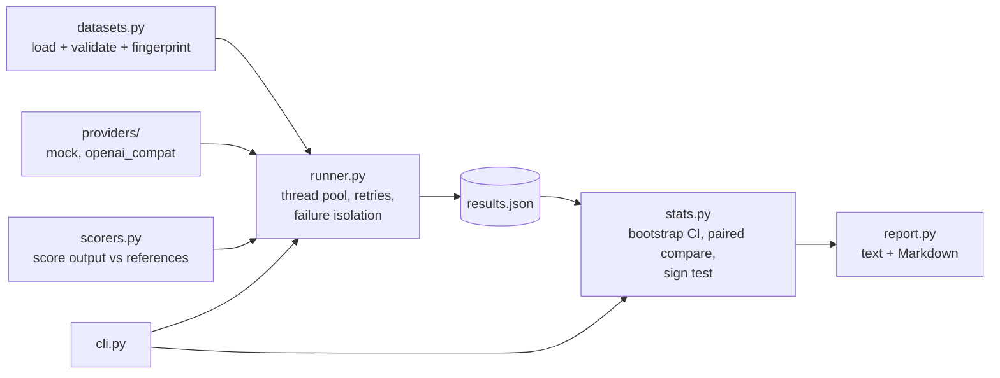

# EvalBench

A small, dependency-free Python harness for **evaluating and comparing AI model outputs** against reference answers, with
reproducible runs, honest statistics, and CI-friendly quality gates.

- **No API keys needed to try it.** A deterministic mock model simulates a model of any chosen accuracy.
- **Real backends too.** Any OpenAI-compatible chat-completions endpoint (hosted or local) works out of the box.
- **Six scorers**: normalized exact match, whole-word containment, token F1, numeric tolerance, regex, and JSON equality.
- **Paired comparisons** with bootstrap confidence intervals and an exact sign test, so "model B is better" is a claim
  you can defend instead of a number you hope is not noise.
- **Gates for CI**: `--fail-under` and `--fail-on-regression` turn an evaluation into a pass/fail check.
- **Standard library only** at runtime; Python 3.10+.

## Quick start

```bash
git clone https://github.com/C123clay/EvalBench.git && cd EvalBench
python -m venv .venv
source .venv/bin/activate          # Windows: .venv\Scripts\activate
pip install -e ".[dev]"
pytest                             # 110 tests, no network access needed
```

Check a dataset:

```console
$ evalbench validate examples/general_qa.jsonl
examples/general_qa.jsonl: 30 examples, 36 references, fingerprint 66913bf30d56903d
tags: arithmetic (8), computing (5), geography (6), language (2), science (7), units (5)
```

Evaluate two models side by side (here, two simulated models configured at 65% and 90% accuracy):

```console
$ evalbench run --dataset examples/general_qa.jsonl \
    --model "mock:oracle?accuracy=0.65&name=baseline" \
    --model "mock:oracle?accuracy=0.9&name=candidate" \
    --scorer contains --output results/qa.json
Dataset general_qa (66913bf30d56903d), scorer contains

model      n   pass rate  95% CI         mean score  errors  avg latency  tokens
---------  --  ---------  -------------  ----------  ------  -----------  ------
baseline   30  66.7%      50.0% - 83.3%  0.667       0       61 ms        277
candidate  30  80.0%      63.3% - 93.3%  0.800       0       61 ms        268

Pass rate by tag:

tag         baseline     candidate
----------  -----------  ------------
arithmetic  75.0% (n=8)  75.0% (n=8)
computing   80.0% (n=5)  80.0% (n=5)
geography   66.7% (n=6)  83.3% (n=6)
language    50.0% (n=2)  100.0% (n=2)
science     57.1% (n=7)  85.7% (n=7)
units       80.0% (n=5)  80.0% (n=5)

First failures for baseline:
  [arith-002] '13' -- no reference found in output
  [arith-005] 'I am not sure.' -- no reference found in output
  [units-002] 'I am not sure.' -- no reference found in output
...
Results written to results/qa.json
```

Then ask whether the difference is real:

```console
$ evalbench compare results/qa.json --baseline baseline --candidate candidate
candidate vs baseline

Paired examples: 30
Mean score: 0.667 -> 0.800 (delta +0.133, 95% CI -0.067 to +0.333)
Per-example: 7 better, 20 same, 3 worse (sign test p = 0.3438)
Verdict: INCONCLUSIVE
Regressions (passed before, fail now): arith-007, units-001, comp-003
```

That verdict is the point of the tool. The candidate *is* better by construction (90% vs 65%), it scored 13 points
higher, and still **30 examples are not enough to prove it**: the confidence interval includes zero. The same pair of
models on a 300-example dataset is reported as `IMPROVED`
(`test_sample_size_decides_whether_a_real_gap_is_detectable` in `tests/test_stats.py`). EvalBench also lists the
examples the candidate newly gets wrong, because an aggregate gain can hide regressions worth reading.

## Datasets

JSON Lines, one example per line (a JSON array, or an object with an `"examples"` array, also works):

```json
{"id": "geo-003", "prompt": "Which ocean lies between Africa and Australia?", "reference": ["Indian Ocean", "the Indian Ocean"], "tags": ["geography"]}
```

| Field | Required | Meaning |
|---|---|---|
| `id` | yes | Stable, unique identifier (string or integer). Comparisons pair examples by `id`. |
| `prompt` | yes | Text sent to the model. |
| `reference` / `references` | yes | One acceptable answer or a list of them; the best match is used. |
| `tags` | no | Labels for per-slice breakdowns (`Pass rate by tag`). |
| `metadata` | no | Free-form object, carried through untouched. |

Validation is strict and points at the problem: unknown fields, duplicate ids (with both line numbers), empty prompts,
and malformed JSON are reported as `file, line N: ...` with exit code 2. Every dataset gets a content **fingerprint**
that is stored in result files, so a result can always be traced back to the exact data it was computed on.

## Models

Models are selected with a spec string: `kind:target?key=value&...`.

| Spec | What it does |
|---|---|
| `mock:oracle?accuracy=0.8&seed=3&name=candidate` | Answers with the reference with probability `accuracy`, otherwise makes a plausible mistake (off-by-one number, truncated answer, or "I am not sure."). |
| `mock:constant?response=Paris` | Always returns the same text. |
| `mock:echo` | Returns the prompt. |
| `mock:rules?file=examples/mock_rules.json&response=unknown` | Regex-to-response rules, with a fallback. |
| `mock:oracle?failure_rate=0.1` | Adds simulated transient failures to exercise retries. |
| `openai:<model>?base_url=http://localhost:8000/v1&api_key_env=MY_KEY` | Any OpenAI-compatible `/chat/completions` endpoint. Also accepts `temperature`, `max_tokens`, `timeout`, `system_prompt`, `name`. |

The API key is read from the environment variable named by `api_key_env` (default `OPENAI_API_KEY`) at call time. It is
never written to result files or logs.

## Scorers

```console
$ evalbench scorers
exact     Normalized exact match against any reference.
contains  A reference appears in the output as whole words.
token_f1  Token-overlap F1; passes at or above `threshold`. [threshold]
numeric   First number in the output equals a reference within tolerance. [abs_tol, rel_tol]
regex     Each reference is a case-insensitive regular expression.
json      Output parses as JSON equal to a reference.
```

Parameters go after a colon: `--scorer token_f1:threshold=0.6`, `--scorer numeric:abs_tol=0.01`. Normalization
(lowercase, no punctuation, no English articles, collapsed whitespace) means `"The Amazon River."` matches `"amazon river"`.
`numeric` understands thousands separators and exponents (`"3,600 seconds"` matches `3600`). `json` tolerates a
surrounding Markdown code fence and ignores key order.

```console
$ evalbench run --dataset examples/extraction.jsonl --model "mock:oracle?accuracy=0.7&seed=2" --scorer json --show-failures 2
...
First failures for mock-oracle:
  [ex-002] '{"city": "Lyon",' -- output is not JSON (Expecting property name enclosed in double quotes)
  [ex-005] 'I am not sure.' -- output is not JSON (Expecting value)
```

## Using it in CI

| Exit code | Meaning |
|---|---|
| `0` | Success |
| `1` | A quality gate failed |
| `2` | Invalid input (bad dataset, spec, scorer, or file) |

```bash
# Fail the build if any model passes fewer than 80% of examples
evalbench run --dataset evals/smoke.jsonl --model "openai:my-model?base_url=$URL" --fail-under 0.8

# Fail only when the candidate is significantly worse than the baseline (CI upper bound below zero)
evalbench compare results.json --baseline prod --candidate pr-build --fail-on-regression
```

`--fail-on-regression` deliberately ignores differences that are not statistically significant, so a noisy small
eval does not block a pull request on luck.

## Architecture



```
src/evalbench/
  datasets.py        Example/Dataset models, JSON/JSONL loading, strict validation, content fingerprint
  scorers.py         Scorers, text normalization, the "name:key=value" scorer spec
  providers/
    base.py          Provider protocol, Completion, ProviderError(retryable)
    mock.py          Deterministic simulator (oracle/echo/constant/rules, failure injection)
    openai_compat.py Standard-library HTTP client for chat-completions endpoints
    __init__.py      "kind:target?key=value" model spec parsing
  runner.py          Concurrent evaluation, retry with exponential backoff, versioned result files
  stats.py           Summaries, percentile bootstrap, paired comparison, exact sign test
  report.py          Plain-text and Markdown tables
  cli.py             validate / run / compare / scorers
```

## Design decisions

- **Deterministic by construction.** Every mock decision is a hash of `(seed, model name, example id)`, not a shared
  random stream. Results therefore do not depend on thread scheduling, worker count, or example order, and a run is
  byte-for-byte reproducible apart from its timestamp (tested with 1 vs 8 workers).
- **The mock is a calibration tool, not a stub.** Because its accuracy is known, it lets the harness test itself: the
  test suite checks that a mock set to 30%, 70%, or 90% is measured within 3 points over 4,000 examples, and that the
  comparison logic reports improvements, regressions, and ties correctly.
- **Paired statistics over raw accuracy.** Comparing models on the same examples removes example difficulty from the
  noise. The percentile bootstrap is seeded for reproducibility; the exact sign test needs no normality assumption and
  works for tiny samples. A verdict is only `improved`/`regressed` when the interval excludes zero.
- **One failed call never sinks a run.** Transient errors (HTTP 408/409/429/500/502/503/504, timeouts, connection failures) are
  retried with exponential backoff; permanent ones are not. A final failure is recorded on its item, scored zero, and
  counted in an `errors` column, so failures are visible instead of silently dropped.
- **Plain, versioned result files.** Results are JSON with a `schema_version`, the dataset fingerprint, the scorer spec,
  and every output, so they can be diffed, archived, and re-analysed with `compare` without re-running models.
- **Standard library only.** Nothing to audit or pin at runtime; `pytest` is the only development dependency. The HTTP
  provider is tested against a local stub server, so the test suite needs no network or credentials.
- **Simple token accounting.** Token counts use reported `usage` when an endpoint provides it and a whitespace count
  otherwise. That is good for relative comparison, not for billing.

## Testing

```bash
pytest
```

The suite covers dataset validation and error messages, each scorer's edge cases, mock determinism and calibration,
model spec parsing, the HTTP provider (success, auth header handling, HTTP error classification, malformed responses,
connection failures) against a local server, runner ordering/retries/failure isolation, the statistics (known sign-test
values, bootstrap reproducibility and coverage), and the CLI end to end including exit codes. CI runs it on Python
3.10 through 3.13 on Linux and on Windows, then smoke-tests the documented commands and both quality gates.

## Limitations and next steps

- Scorers are lexical. A model-graded ("LLM-as-judge") scorer with its own agreement checks would be the natural next one.
- Calls are synchronous on a thread pool; very large runs against rate-limited APIs would benefit from async I/O and
  per-provider rate limiting.
- Only the chat-completions protocol is supported for real models; other providers fit behind the same `Provider`
  protocol.

## License

MIT. See [LICENSE](LICENSE).
